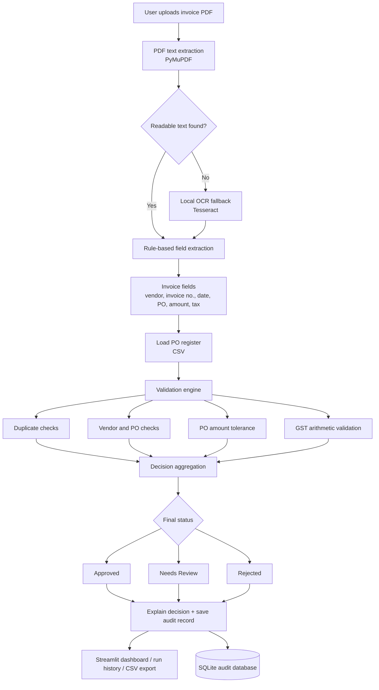

# SmartInvoice AI — Architecture and workflow

## Component overview

## Processing stages

1. **Input:** A user uploads a PDF invoice in the Streamlit interface.
2. **Text acquisition:** PyMuPDF reads embedded text. If the PDF is image-only, the application attempts OCR through the locally installed Tesseract executable.
3. **Extraction:** Regular expressions and deterministic parsing rules identify the invoice fields.
4. **PO matching:** The extracted PO number is matched against `data/purchase_orders.csv`.
5. **Validation:** The engine checks duplicates, required fields, extraction completeness, PO existence/status, vendor consistency, amount tolerance and GST arithmetic.
6. **Decision:** A blocking duplicate or unapproved PO can result in Rejected; uncertain or mismatched data is routed to Needs Review; otherwise the invoice is Approved under the configured demo rules.
7. **Audit and visibility:** The result and extracted fields are saved to SQLite and displayed with reasons/checks in the UI.

## Decision principles

- **Approved:** All configured checks pass.
- **Needs Review:** A discrepancy or uncertainty requires a human decision.
- **Rejected:** A configured blocking condition is detected, such as an exact duplicate or a PO that is not approved.

The decision is a prototype recommendation. It is not an instruction to pay an invoice.
